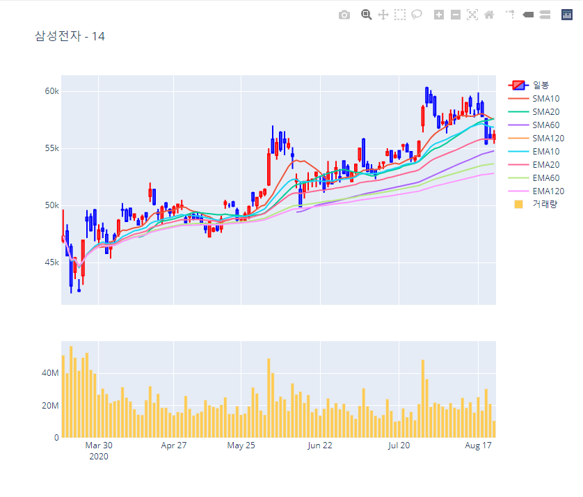

# stock-graph-analyser
Generate stock chart and score  

## [DailyScore](./export/score-result.md)  
You must do it at your own discretion and responsibility, and it is recommended that you diversify your investments with your own spare funds.

## Example



## Requirements
[](https://www.python.org/downloads/)

## Project Structure

```
├── config.py                      # Central configuration (paths, thresholds, etc.)
├── logger.py                      # Logging setup
├── main.py                        # Entry-point – orchestrates the pipeline
├── stock_analyser.py              # Scoring engine (MA, RSI, MACD, volume)
├── stock_data_frame_generator.py  # Fetch & build enriched DataFrames
├── stock_graph_generator.py       # Plotly candlestick + volume charts
├── stock_summary.py               # Domain model for a single stock
├── stock_summary_parser.py        # Parse the Excel stock list
├── requirements.txt
├── export/
│   ├── graph/                     # Generated HTML charts
│   ├── score/                     # Score marker files
│   └── score-result.md            # Aggregated Markdown report
└── resource/
    └── stock_list.xlsm            # Master stock list
```

## Quickstarts

```bash
# Install packages
pip install -r requirements.txt

# Run (production – all stocks)
python main.py

# Run in test mode (single stock: 삼성전자)
TEST_MODE=true python main.py

# Override settings via environment variables
RESTRICT_STOCK_COUNT=50 THREAD_COUNT=8 python main.py
```

## Configuration

All tunable parameters live in `config.py` and can be overridden via
environment variables:

| Variable | Default | Description |
|---|---|---|
| `TEST_MODE` | `false` | Process only 삼성전자 when `true` |
| `RESTRICT_STOCK_COUNT` | `1000` | Max stocks to load from Excel |
| `THREAD_COUNT` | `64` | Worker threads for parallel processing |
| `PAGE_COUNT` | `12` | Naver Finance pages to fetch per stock |
| `RESOURCE_EXCEL_PATH` | `./resource/stock_list.xlsm` | Path to the stock list |
